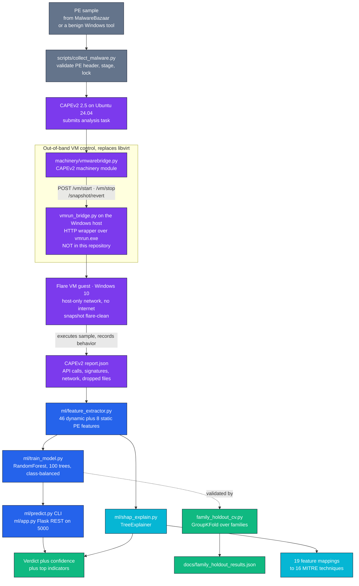
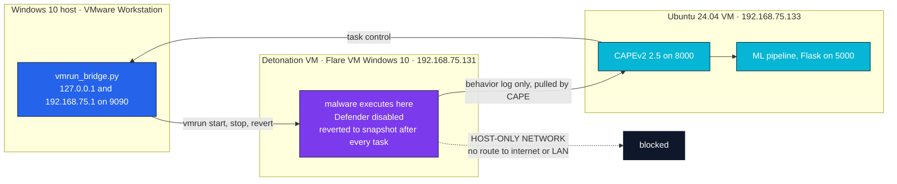
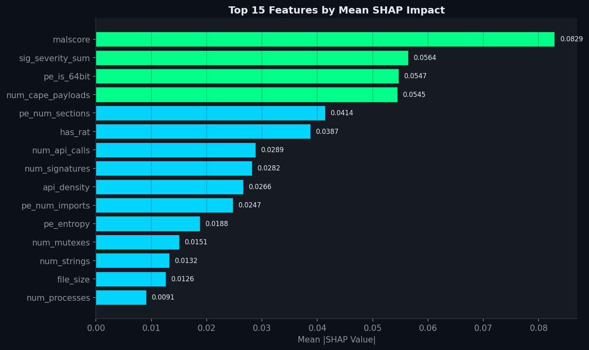
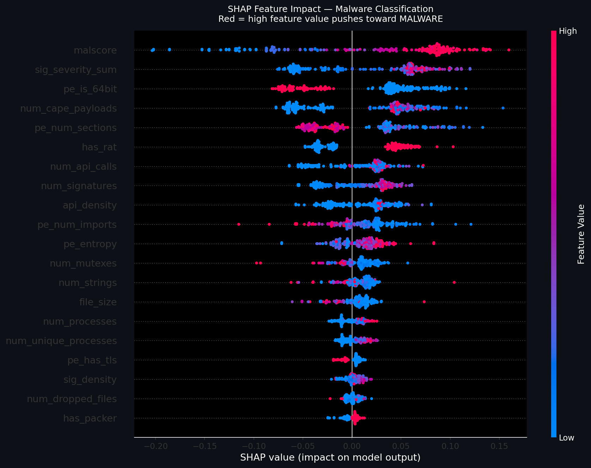
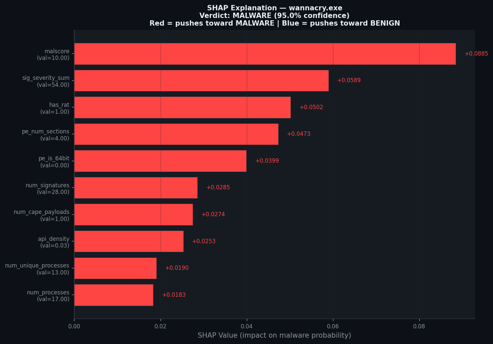
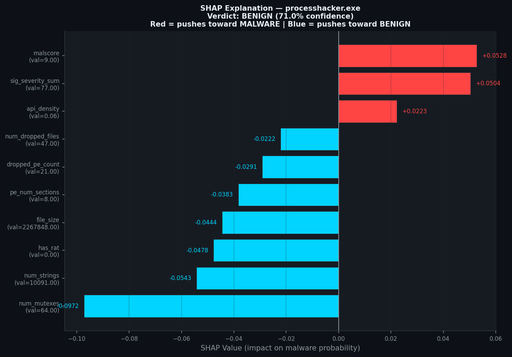

<div align="center">

# 🧬 MalTrace

### Behavioral malware detection with family-held-out validation and SHAP explainability

**A full detection pipeline, not a notebook: CAPEv2 executes the sample, 54 behavioral and static
features are extracted from the sandbox report, a Random Forest classifies it, SHAP explains the
verdict feature by feature, and active features are mapped to MITRE ATT&CK.
The headline result is measured by holding out entire malware families — the test that shows
generalisation rather than memorisation.**

[](ml/)
[](ml/train_model.py)
[](ml/shap_explain.py)
[](machinery/vmwarebridge.py)
[](ml/app.py)

[](docs/family_holdout_results.json)
[](docs/benign_torture_results.json)
[](docs/VALIDATION.md)
[](#-known-limitations)

[Problem](#-the-detection-problem) · [Pipeline](#-analysis-pipeline) · [Features](#-feature-engineering) · [Model](#-model-architecture) · [Validation](#-training-and-evaluation) · [Held-out](#-family-held-out-validation) · [Explainability](#-explainability) · [ATT&CK](#-mitre-attck-context) · [Errors](#-error-analysis) · [Reproduce](#-reproducibility) · [Limits](#-known-limitations)

📖 [Full technical write-up on Medium](https://medium.com/@vishvatejack/building-maltrace-a-behavioral-malware-analysis-pipeline-with-explainable-ai-4b34db31ad21)

</div>

---

## 📌 Overview

| | |
|---|---|
| **What it does** | Runs a PE sample in a CAPEv2 sandbox, extracts 54 behavioral and static features from the resulting report, classifies malware vs benign with a Random Forest, produces a SHAP explanation for every prediction, and maps the active behavioral features to MITRE ATT&CK techniques. |
| **The problem it solves** | Most ML malware classifiers are validated with a random train/test split, so samples from the same family appear on both sides. That measures recall of families the model has already seen. MalTrace is built around the family-held-out test instead. |
| **Who benefits** | Anyone who needs a *reviewable* verdict. A classifier that says "malware, 0.91" is unusable in triage; one that says "malware, 0.91, driven by shadow-copy deletion and 28 signatures" can be checked by an analyst. |
| **Why this architecture** | CAPEv2 defaults to libvirt/KVM, which is unstable when Ubuntu itself runs inside VMware. Rather than fight nested virtualisation, the sandbox's machinery layer was replaced with an HTTP bridge to `vmrun.exe` on the Windows host. |

---

## 🎯 The Detection Problem

A behavioral classifier has two ways to be useless, and a random split hides both:

1. **It memorises families.** Train on 4 WannaCry samples, test on the 5th, report 0.99 F1 — and
   learn nothing about the next ransomware family. The honest test holds out *every* sample of a
   family and asks the model about a family it has never seen.
2. **It fires on admin tools.** Behaviorally, `ProcessHacker`, `AnyDesk` and `mspaint` look alarming:
   they open handles into other processes, modify memory, touch the clipboard. CAPEv2's own signature
   engine scores `mspaint.exe` at malscore **9.0**. A classifier that inherits that scoring is a
   false-positive generator.

MalTrace is evaluated against both failure modes, and both results are published as JSON in
[`docs/`](docs/) rather than asserted here.

---

## 🧱 Analysis Pipeline



### Security boundary



The detonation VM is on a host-only network with no route to the internet or the LAN, Windows
Defender is disabled so it cannot pre-empt the sample, and the VM is reverted to the `flare-clean`
snapshot after every task.

> `vmrun_bridge.py` runs on the Windows host and is **not committed to this repository** — it sits
> outside the analysis environment by design. The CAPEv2-side counterpart that calls it,
> [`machinery/vmwarebridge.py`](machinery/vmwarebridge.py), is committed.

---

## ✨ Capability Matrix

| Capability | Behaviour | Status |
|---|---|---|
| CAPEv2 behavioral analysis via custom VMware bridge | Replaces libvirt entirely; sandbox is unaware it is driving VMware | **Implemented** |
| 54-feature extraction with null-safe parsing | Every field access defaulted; malformed reports no longer crash the extractor | **Implemented** |
| Random Forest malware classification | 100 trees, balanced class weights, feature names pickled with the model | **Implemented** |
| Family-held-out cross-validation | GroupKFold over 64 families, 5 folds, no skipped folds | **CI-free, result stored** in [`family_holdout_results.json`](docs/family_holdout_results.json) |
| Benign false-positive torture test | 75 Windows system, admin, dev and security tools | **Validated**, 0 FP |
| SHAP global and per-sample explanations | Beeswarm, bar and waterfall plots plus JSON explanation | **Implemented** |
| MITRE ATT&CK mapping | 19 feature-to-technique mappings, SHAP impact attached | **Implemented** |
| Flask REST prediction API | `POST /predict` with a report file | **Implemented** |
| Chaos / self-healing validation | 6 scenarios; 1 live injection, several code-level checks | **Partially validated** — see [Error analysis](#-error-analysis) |
| Temporal (concept-drift) validation | Collection timestamps were never captured at ingestion | **Not implemented** |
| Evasive-sample evaluation | Needs sleeping and anti-VM samples | **Planned** |
| Non-PE formats, drift monitoring, retraining policy | — | **Not implemented** |

---

## 🧮 Feature Engineering

**54 features: 46 dynamic behavioral + 8 static PE.** The count is deliberate — every feature maps
to a stated detection hypothesis, either a known malware behaviour or a known benign
false-positive pattern.

<details>
<summary><b>Dynamic behavioral features (46)</b></summary>

| Category | Features | Detection hypothesis |
|---|---|---|
| CAPE scoring | `malscore`, `sig_severity_sum`, `num_signatures` | Rule-based aggregate suspicion from CAPEv2's own engine |
| Process injection | `VirtualAllocEx` + `WriteProcessMemory` + `CreateRemoteThread` pattern | T1055 — code injection into a remote process |
| Persistence | Run/RunOnce/Winlogon registry writes | T1547 — survives reboot |
| Ransomware | `vssadmin` / `wmic shadowcopy` deletion, encryption API sequences | T1486, T1490 — encrypt and destroy recovery |
| Evasion | `NtDelayExecution` > 60s, anti-debug and anti-sandbox signatures | T1497, T1622 — sleep past the sandbox timeout |
| Credential access | `OpenProcess(lsass)` + `ReadProcessMemory` | T1003 — LSASS dumping |
| Network | `unique_ips`, `unique_domains`, `smtp_connections`, `network_before_files` | C2 check-in and exfiltration |
| API density | `api_calls` / `process_count` ratio | Malware tends to be API-heavy per process |
| Process tree | spawn-chain depth and suspicious chains | T1059 — interpreter chains |
| Payloads / drops | `num_cape_payloads`, `dropped_pe_count` | Unpacking and dropper behaviour |

</details>

<details>
<summary><b>Static PE features (8)</b></summary>

| Feature | What it detects |
|---|---|
| `pe_entropy` | Max section entropy — high means packed or encrypted (WannaCry: 7.99) |
| `pe_num_sections` | Unusual section count suggests a custom packer |
| `pe_has_upx` | UPX packer present |
| `pe_wx_section` | Writable **and** executable section — self-unpacking code |
| `pe_num_imports` | Too few implies packed; the distribution is informative either way |
| `pe_is_64bit` | Architecture — modern malware skews 64-bit, many benign system tools are 32-bit |
| `pe_is_signed` | Code signing — legitimate software is usually signed |
| `pe_has_tls` | TLS callbacks, commonly used for anti-debug |

If the PE header is malformed, all eight fall back to zeros rather than throwing.

</details>

---

## 🤖 Model Architecture

| Choice | Value | Why |
|---|---|---|
| Algorithm | `RandomForestClassifier`, 100 trees | Tree ensembles handle the mixed scale of these features (counts, booleans, entropy floats) without scaling, and `TreeExplainer` gives exact SHAP values rather than approximations |
| Class weights | `balanced` | 158 malware vs 76 benign in a 234-sample dataset |
| Feature alignment | Feature names pickled alongside the model | An early version let `predict.py` and `shap_explain.py` silently misalign columns — the names are now part of the artifact |
| Explainer | SHAP `TreeExplainer` | Exact for tree models; handles both the list-of-arrays and 3-D return shapes across SHAP versions |

**Why not a neural network or gradient boosting?** With 234 samples, model capacity is not the
binding constraint — dataset size is. A 100-tree forest is already in the regime where the family
holdout, not the architecture, determines the score, and it buys exact explainability for free.

---

## 📊 Training and Evaluation

| Property | Value |
|---|---|
| Samples | **234** (158 malware, 76 benign) |
| Canonical malware families | **64** |
| Families with ≥ 2 samples | **37** — the cohort used for the binary F1 |
| Single-sample families | **27** — cannot demonstrate cross-sample generalisation |
| Folds | **5**, GroupKFold over families, **zero skipped folds** |

### Model evolution

| Version | Samples | Features | Stratified CV F1 | What changed |
|---|---|---|---|---|
| v1 MVP | 2 | 17 | 0.824 ± 0.162 | WannaCry + EICAR only |
| v2 | 103 | 17 | 0.923 ± 0.042 | MalwareBazaar collection pipeline |
| v3 | 104 | 46 | 0.935 ± 0.015 | Added static PE features |
| v4 | 176 | 46 | 0.950 ± 0.016 | Expanded dataset |
| **v5 (current)** | **234** | **54** | **0.957 ± 0.016** | Ratio features, hardened extractor |

---

## 🧪 Family-Held-Out Validation

Each fold removes **every sample of a disjoint set of malware families** from training, then scores
the model on exactly those unseen families. Benign samples are split normally across folds — a
standard `GroupKFold` would also group them, which would create an unrealistic test.

| Metric | Value |
|---|---|
| **Family-holdout F1** | **0.975 ± 0.008** |
| Baseline stratified CV F1 | 0.957 ± 0.016 |
| Difference vs baseline | **+0.018** (holdout exceeded baseline) |
| Multi-family binary F1 | 0.973 ± 0.010 |
| Recall on unseen multi-sample families | 0.985 ± 0.019 |
| False negatives | **2 / 158** malware |
| False positives | **0** |

### Per fold

Straight from [`docs/family_holdout_results.json`](docs/family_holdout_results.json):

| Fold | Families held out | F1 | Recall | Precision | FN | FP |
|---|---|---|---|---|---|---|
| 1 | 13 | 0.9688 | 0.9688 | 0.9688 | 1 | 1 |
| 2 | 13 | 0.9688 | 0.9688 | 0.9688 | 1 | 1 |
| 3 | 13 | 0.9688 | 0.9688 | 0.9688 | 1 | 1 |
| 4 | 12 | 0.9841 | 1.0000 | 0.9688 | 0 | 1 |
| 5 | 13 | 0.9841 | 1.0000 | 0.9688 | 0 | 1 |

**How to read the +0.018.** The holdout score landing *above* the stratified baseline is consistent
with the model using generalisable behavioral signals rather than family-specific signatures. It is
not evidence that holding families out makes the task easier — with 5 folds and a 234-sample
dataset, a 0.018 difference sits close to the fold-to-fold spread (±0.008 and ±0.016), so the
defensible claim is that **family holdout did not degrade performance**, not that it improved it.

### Benign torture test

75 Windows system binaries, admin tools, dev tools and security utilities through the same sandbox
and classifier ([`benign_torture_results.json`](docs/benign_torture_results.json)):

| Metric | Value |
|---|---|
| **False positives** | **0 / 75** (0.0%, target < 5%) |
| Max confidence on a benign sample | 0.370 — `mspaint.exe` |
| Mean confidence on benign | 0.059 |
| Median confidence on benign | 0.010 |

| Hardest case | CAPEv2 malscore | ML confidence | Verdict |
|---|---|---|---|
| `mspaint.exe` | 9.0 | 0.370 | ✅ BENIGN |
| `AnyDesk.exe` | 9.0 | 0.340 | ✅ BENIGN |
| `calc.exe` | 8.0 | 0.340 | ✅ BENIGN |
| `ProcessHacker` | 7.0 | 0.290 | ✅ BENIGN |
| `KeePass.exe` | — | 0.260 | ✅ BENIGN |
| `WizTree64.exe` | — | 0.240 | ✅ BENIGN |

CAPEv2's signature engine scores `mspaint.exe` at 9.0 because it opens files, modifies memory and
reads the clipboard — each suspicious in isolation. Weighing all 54 features together, the ML layer
classifies it benign. **This is the specific thing the ML layer adds over the signature engine.**

**Coverage gap:** Wireshark, Nmap, PsExec, Autoruns and CCleaner are *not* in the benign set yet, and
they are exactly the kind of dual-use tooling most likely to produce a false positive. The 0/75 result
should be read with that in mind.

---

## 🔬 Explainability

Every prediction carries a SHAP explanation — which features drove the verdict, and by how much.

### Global feature importance



`malscore` and `sig_severity_sum` dominate, which is expected: they aggregate CAPEv2's rule-based
signatures. `pe_is_64bit` ranking third reflects that most modern malware is 64-bit while many
benign system tools are still 32-bit — a real signal in this dataset and also a reminder that it is
a **dataset artifact**, not a law of malware.

### Feature impact distribution



Red is a high feature value pushing toward MALWARE, blue is a low value pushing toward BENIGN. The
spread matters: no single feature carries the decision.

### Per-sample — WannaCry (malware)



WannaCry triggers everything at once: malscore 10, 28 signatures, 94,958 API calls, a CAPE payload
extracted. Every red bar is a behaviour an analyst can verify independently.
Raw values: [`shap_wannacry_exe.json`](docs/images/shap_wannacry_exe.json)

### Per-sample — ProcessHacker (benign)



A legitimate admin tool with elevated signatures (malscore 9, `sig_severity` 77), classified BENIGN
at 71% confidence — driven by `num_mutexes=64` and a 2.2 MB file size pushing away from malware.
The point is not that it got the answer right; it is that the rationale is auditable.

---

## 🧩 MITRE ATT&CK Context

The classifier itself is binary. ATT&CK mapping is a reporting layer:
[`ml/shap_explain.py`](ml/shap_explain.py) holds **19 feature-to-technique mappings covering 16
distinct techniques**, emitted per prediction for whichever features are active, with the SHAP
impact attached.

| Feature | Technique | Name | Tactic |
|---|---|---|---|
| `has_ransomware` | T1486 | Data Encrypted for Impact | Impact |
| `has_shadow_deletion` | T1490 | Inhibit System Recovery | Impact |
| `has_process_injection` | T1055 | Process Injection | Privilege Escalation / Defense Evasion |
| `has_persistence` | T1547 | Boot or Logon Autostart Execution | Persistence |
| `has_credential_access` | T1003 | OS Credential Dumping | Credential Access |
| `has_antidebug` | T1622 | Debugger Evasion | Defense Evasion |
| `has_antisandbox` | T1497 | Virtualization / Sandbox Evasion | Defense Evasion |
| `has_sleep_evasion` | T1497 | Virtualization / Sandbox Evasion | Defense Evasion |
| `has_packer` | T1027 | Obfuscated Files or Information | Defense Evasion |
| `has_stealth` | T1036 | Masquerading | Defense Evasion |
| `has_network_sig` | T1071 | Application Layer Protocol | Command & Control |
| `network_before_files` | T1071 | Application Layer Protocol (C2 check-in pattern) | Command & Control |
| `has_rat` | T1219 | Remote Access Software | Command & Control |
| `has_dropper` | T1105 | Ingress Tool Transfer | Command & Control |
| `has_keylogger` | T1056 | Input Capture | Collection |
| `has_banker` | T1056 | Input Capture: Credential API Hooking | Collection |
| `has_infostealer` | T1041 | Exfiltration Over C2 Channel | Exfiltration |
| `has_uac_bypass` | T1548 | Abuse Elevation Control Mechanism | Privilege Escalation |
| `suspicious_spawn_chains` | T1059 | Command and Scripting Interpreter | Execution |

Example output for WannaCry:

```
MITRE ATT&CK TTPs Detected:
  T1486  Data Encrypted for Impact        (SHAP: +0.2870)
  T1622  Debugger Evasion                 (SHAP: +0.1430)
  T1027  Obfuscated Files or Information  (SHAP: +0.0710)
  T1071  Application Layer Protocol       (SHAP: +0.0650)
```

> These techniques are **inferred from CAPEv2 signature flags**, not independently confirmed by
> analyst review of each sample. Treat them as triage context, not as a verified ATT&CK assessment.

---

## 🔎 Error Analysis

### The two false negatives

| Sample | Confidence | Why it was missed |
|---|---|---|
| `trickbot` | 0.430 | Modular banking trojan — deliberately staged, low-noise behaviour before the payload stage. Little to observe inside the sandbox window. |
| `cerber` | 0.490 | Older ransomware with a quiet pre-encryption phase that generates minimal API activity. |

Both sit just under the 0.5 decision threshold. Both are **behavioral-visibility** failures, not
feature-engineering failures: the sandbox did not observe enough activity to classify them.

### 80/20 holdout (not temporal validation)

Temporal validation was attempted and **abandoned as invalid** — MalwareBazaar's `first_seen` field
was never piped through the collection orchestrator, so the dataset has no real collection dates.
What remains is a standard holdout split:

| Metric | Value |
|---|---|
| F1 | 0.933 |
| Recall | 0.955 |
| Precision | 0.913 |
| False positives | 2 — `KeePass.exe` (0.780), `WizTree64.exe` (0.530) |
| False negatives | 1 — Sliver C2 framework (0.250) |

`KeePass.exe` at 0.780 confidence is the most interesting failure in the project: a password manager
behaves like credential-access malware. It is classified correctly in the benign torture run and
incorrectly here, which is what a 234-sample dataset looks like at the decision boundary.

### Chaos engineering — mixed methods, no aggregate number

Six failure scenarios were assessed ([`chaos_results.json`](docs/chaos_results.json)): 6 failures
detected, 6 healer triggers, 5 recoveries.

| Scenario | Validation mode | Observation |
|---|---|---|
| Bridge kill | **Unavailable** | The bridge was already offline; recovery was not demonstrated |
| Corrupt report | **Live injection** | Truncated and garbage-injected report restored from backup |
| Snapshot miss | Code-level check | RULE-002 path inspected in `cape_healer.py` |
| Partial BSON | Code-level check | RULE-009/010 paths inspected |
| Execution timeout | Code-level check | Healer rule paths inspected; CAPE API returned HTTP 200 |
| Extractor robustness | Local edge-case check | Null-guard fix assessed against malformed reports |

The results file records its own aggregate field as
`"withdrawn: mixed live and code-level checks do not define one resilience percentage"`.
**There is no resilience percentage for this pipeline and this README does not state one.**

**Real bug found by this work:** `feature_extractor.py` crashed on null `behavior`/`network`
sections in malformed reports. Fixed with null-safe guards on every field access.

---

## 🧰 Technology Stack

| Component | Technology | Why |
|---|---|---|
| Sandbox | CAPEv2 2.5 on Ubuntu 24.04 | Behavioral reports with a signature engine and payload extraction already built in |
| Detonation VM | Flare VM (Windows 10, host-only) | Pre-built analysis tooling; host-only keeps samples off the network |
| VM control | Flask + `vmrun.exe` bridge (custom) | Nested KVM inside VMware is unstable; this bypasses libvirt entirely |
| Model | scikit-learn `RandomForestClassifier` | No feature scaling needed; exact SHAP via `TreeExplainer` |
| Explainability | SHAP `TreeExplainer` | Per-prediction attribution an analyst can audit |
| Serving | Flask REST on `:5000` | Lets CAPEv2's processing pipeline call the classifier after each run |
| Validation | `GroupKFold` over families, benign torture, chaos harness | Family holdout is the claim; the others bound the failure modes |
| Collection | MalwareBazaar API | Family-tagged samples, needed for group-wise splitting |

---

## 📂 Repository Structure

```
Maltrace/
├── ml/
│   ├── feature_extractor.py      # 46 dynamic + 8 static PE features, null-safe
│   ├── train_model.py            # RandomForest training, pickles model + feature names
│   ├── predict.py                # CLI verdict with top indicators
│   ├── shap_explain.py           # global + per-sample SHAP, ATT&CK mapping
│   └── app.py                    # Flask REST API, POST /predict
├── machinery/
│   └── vmwarebridge.py           # CAPEv2 machinery module, replaces libvirt with HTTP
├── family_holdout_cv.py          # GroupKFold-over-families implementation
├── stress_tests/
│   ├── test_family_holdout.py    # holdout runner
│   ├── test_benign_torture_final.py  # 75 benign tools, asserts zero FP
│   └── test_chaos_pipeline.py    # 6 failure scenarios
├── tests/cica_break_tests.py     # pipeline break tests
├── scripts/
│   ├── collect_malware.py        # MalwareBazaar collection, staging + locking
│   ├── phase3_build_dataset.py   # dataset assembly
│   └── submit_batch.sh           # batch submission to CAPEv2
└── docs/
    ├── VALIDATION.md             # full robustness report
    ├── family_holdout_results.json
    ├── benign_torture_results.json
    ├── chaos_results.json
    └── images/                   # SHAP bar, beeswarm, waterfalls
```

---

## 🚀 Reproducibility

```bash
# Family-held-out validation (regenerates docs/family_holdout_results.json)
python3 family_holdout_cv.py

# Benign false-positive torture test
python3 stress_tests/test_benign_torture_final.py

# Chaos scenarios
python3 stress_tests/test_chaos_pipeline.py

# Single-sample prediction from a CAPEv2 report
python ml/predict.py /opt/CAPEv2/storage/analyses/294/reports/report.json

# SHAP: global plots, then one sample
sudo python3 ml/shap_explain.py --global-only
sudo python3 ml/shap_explain.py --task 15

# Serve predictions
python ml/app.py
curl -X POST http://localhost:5000/predict -F "report=@/path/to/report.json"
```

> **Reproducibility limits, stated plainly.** These commands are the ones used to produce the
> results in `docs/`, but the full environment **cannot be reproduced from this repository alone**:
> it needs a CAPEv2 2.5 install, a licensed VMware Workstation host, a Flare VM guest with a
> `flare-clean` snapshot, the host-side `vmrun_bridge.py`, and the malware corpus itself — which is
> deliberately not published. The committed JSON results files are the reproducible artifact. There
> is no CI in this repository and therefore no CI badge.

---

## 🔧 Engineering Decisions

| Decision | Reasoning | Rejected alternative |
|---|---|---|
| Replace CAPEv2's libvirt machinery with an HTTP bridge to `vmrun.exe` | Nested KVM inside VMware Workstation is unstable; the sandbox needs reliable start/stop/revert | Running CAPEv2 on bare-metal KVM — correct, but not available on this hardware |
| GroupKFold over families with a custom benign splitter | Grouping benign samples too would make the test unrealistically easy to fail | Stock `GroupKFold` on all samples |
| Compute binary F1 on the 37 multi-sample families only | A single-sample family cannot demonstrate cross-sample generalisation, so including it would flatter the metric | Reporting one F1 over all 64 families |
| Pickle feature names with the model | Silent column misalignment between training and inference was a real bug here | Relying on dict ordering |
| Null-safe defaults on every report field | Malformed and truncated sandbox reports are normal, not exceptional | Letting `KeyError` propagate |
| Publish the withdrawn resilience metric as withdrawn | Mixing one live recovery with code-reading cannot produce a percentage | Keeping a round number nobody can reproduce |
| Count API calls per process then sum | CAPEv2's global count is sometimes miscalculated | Trusting the global field |

---

## 🚧 Known Limitations

| Limitation | Detail |
|---|---|
| **Research lab, not an EDR** | 234 samples from MalwareBazaar in a single sandbox. No production telemetry, no endpoint agent, no claim about production detection performance. |
| **27 single-sample families** | They are in the 64-family total but cannot demonstrate cross-sample generalisation. The binary F1 is computed on the 37 multi-sample families. |
| **No temporal validation** | Collection timestamps were never captured, so concept drift over time is entirely untested. |
| **PE binaries only** | No scripts, macros, LNK, PDF, PowerShell or MSI support. |
| **VMware artifacts are detectable** | Evasion-aware malware can fingerprint the hypervisor and behave benignly. Evasive samples are not yet in the corpus. |
| **ATT&CK mapping is signature-derived** | Inferred from CAPEv2 flags, not confirmed per sample by analyst review. |
| **Benign set has a dual-use gap** | Wireshark, Nmap, PsExec, Autoruns, CCleaner are absent — the hardest FP candidates. |
| **No drift monitoring or retraining policy** | A deployed model would need both. |
| **Chaos validation is partial** | One live injection; the rest are code-level checks. No aggregate resilience figure exists. |
| **Not a vulnerability-free claim** | Zero false positives on 75 tools bounds one failure mode on one corpus. It does not mean the classifier is correct in general. |

---

## 🧭 Roadmap

None of the following is implemented.

| Planned | Why it matters |
|---|---|
| Pipe `first_seen` through the collection orchestrator | Unlocks genuine temporal / concept-drift validation |
| Add ≥ 2 samples for the 27 singleton families | Lets every family contribute to the holdout claim |
| Collect sleeping and anti-VM samples | Measures the evasion blind spot instead of noting it |
| Add Wireshark, Nmap, PsExec, Autoruns, CCleaner to the benign corpus | Tests the dual-use false-positive boundary |
| Live chaos run against an operational bridge | Converts code-level checks into observed recoveries |
| Non-PE support (scripts, macros, LNK) | Covers the delivery formats most used in the wild |

---

## 📚 Evidence & Documentation

| Artifact | Contents |
|---|---|
| [`docs/VALIDATION.md`](docs/VALIDATION.md) | Full robustness report — all five stress tests with their status |
| [`docs/family_holdout_results.json`](docs/family_holdout_results.json) | Baseline and holdout F1, per-fold F1/recall/precision/FN/FP, held-out family lists |
| [`docs/benign_torture_results.json`](docs/benign_torture_results.json) | All 75 benign samples with tool name, verdict and confidence |
| [`docs/chaos_results.json`](docs/chaos_results.json) | Six scenarios with per-test validation mode and the withdrawn aggregate field |
| [`docs/images/`](docs/images/) | SHAP bar, beeswarm and waterfall plots, plus the raw WannaCry SHAP JSON |
| [`family_holdout_cv.py`](family_holdout_cv.py) | The validation implementation itself |
| [Medium write-up](https://medium.com/@vishvatejack/building-maltrace-a-behavioral-malware-analysis-pipeline-with-explainable-ai-4b34db31ad21) | Narrative build log |

---

## 🧯 Disclaimer

Malware is executed only inside an isolated, host-only sandbox with no route to the internet or any
LAN, and the detonation VM is reverted to a clean snapshot after every analysis. No malware samples
are distributed in this repository. All work is for defensive detection research.

---

## 👨‍💻 Author

**Vishva Teja Chikoti** — Cybersecurity · Security Engineering · QA Automation
M.S. Cybersecurity & Networks, University of New Haven (Aug 2023 – Dec 2025) · CompTIA Security+

[](https://github.com/ckvishwa)
[](https://linkedin.com/in/vishvack)
[](mailto:vishvatejack@gmail.com)
